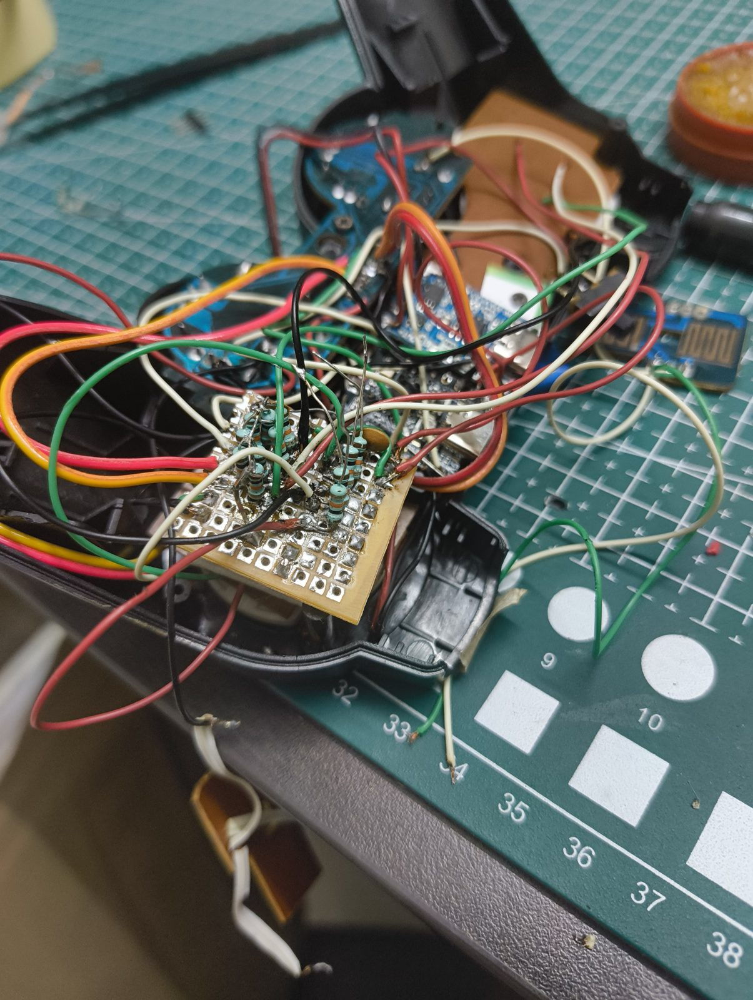
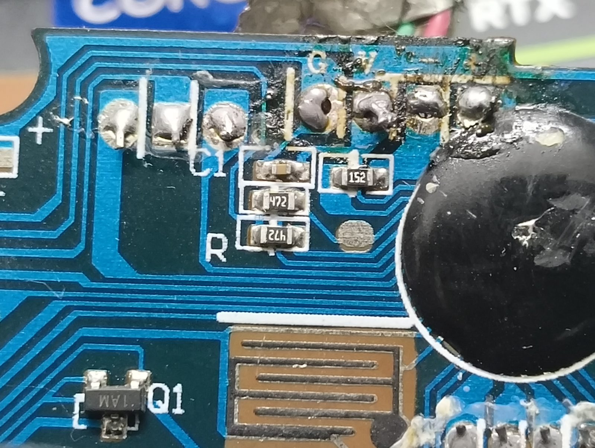
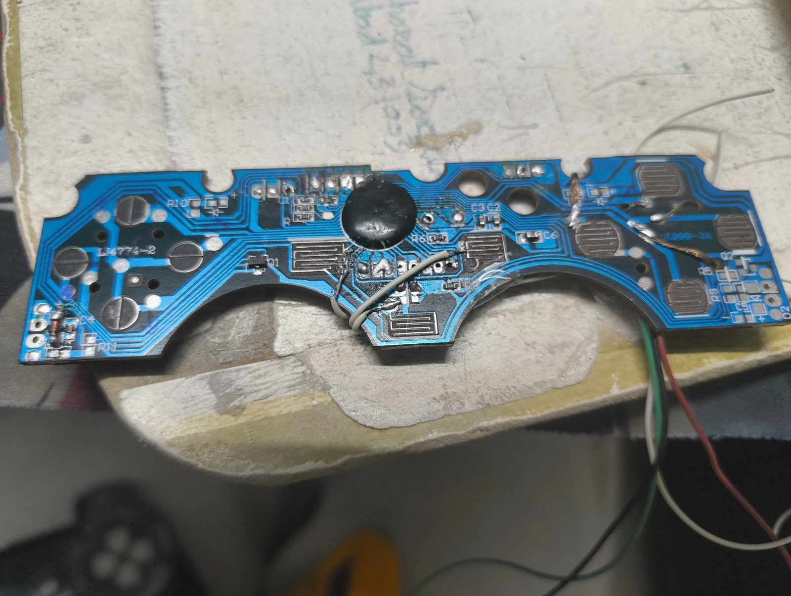
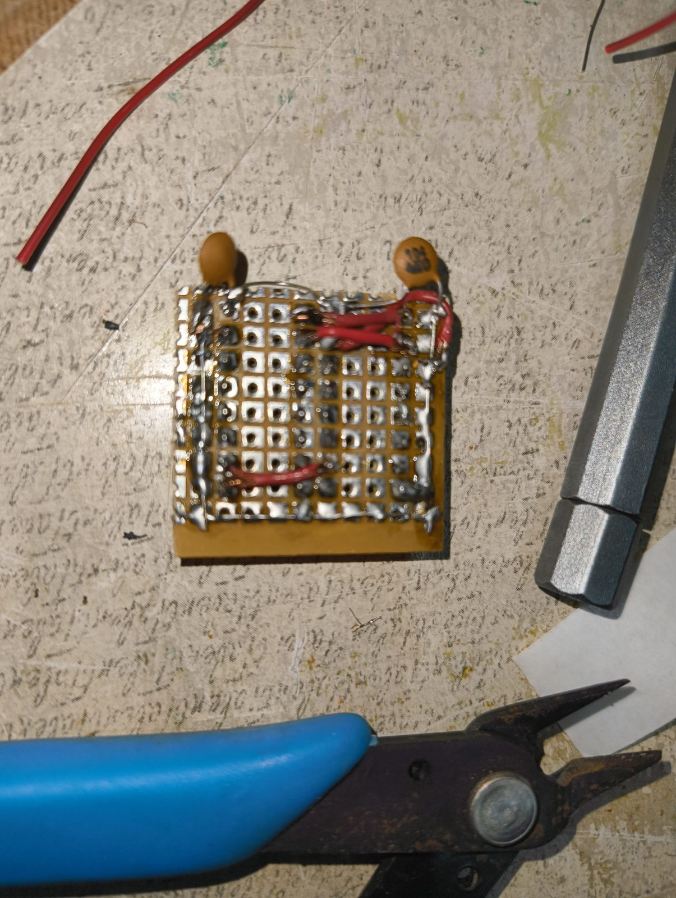

# Wired to Wireless Gamepad

How to turn a cheap wired USB gamepad (the generic PS2-style pads sold everywhere under
dozens of brand names) into a Bluetooth controller that phones, PCs and tablets recognise
as an Xbox controller, using an ESP32-C3 SuperMini and two shift registers.

The pad's original electronics are bypassed completely. Only the shell, the button
membranes, the D-pad, the shoulder buttons and the analog sticks are reused. Everything
else is new, so the method works on almost any pad of this type, even a dead one.



Video: [the finished controller in Steam's controller tester, over Bluetooth](media/videos/04_final-test-steam-controller-tester.mp4).
The build log with photos and videos of the original conversion is in
[JOURNEY.md](JOURNEY.md).

## What you get

- Bluetooth LE controller that appears as an **Xbox Series X|S controller** (`045E:0B13`):
  Android, Windows, Linux and iOS map every button with no drivers or setup.
- 16 buttons, two analog sticks, a Mode/Guide button and full-press digital triggers.
- Trusted-device pairing: the pad only reconnects to devices you paired, and a button
  combination opens pairing for a new device.
- Optional wired mode over USB on Linux (through a small helper program).
- A browser-based tester and calibration wizard that maps your buttons and measures your
  sticks, so you can wire the buttons in any order.
- Rechargeable LiPo battery with USB-C charging.

## How it works

Cheap pads put a single epoxy-covered chip (the black blob) on the main board. Each
button is a pair of interleaved copper fingers, shorted by a carbon pill on the rubber
membrane when pressed. One finger of every button connects to a shared "common" trace,
the other to its own trace leading to the chip.

The conversion cuts the chip out of the circuit and reads the button traces directly:

```
 button pads ──┬── 10 kΩ pull-down ── GND
               │
         74HC165 ×2 (16 inputs, daisy-chained)
               │  LOAD / CLK / DATA
         ESP32-C3 SuperMini ── Bluetooth LE ── phone / PC
               │  ADC
          analog sticks (potentiometers on 3.3 V)
```

The button common is connected to 3.3 V, so a pressed button reads high. Two 74HC165
parallel-to-serial shift registers turn 16 buttons into three wires. The sticks are
plain potentiometers read by the ESP32's ADC. The ESP32-C3 runs the firmware in
`firmware/quantum_pad/`, which presents a standard Bluetooth HID gamepad.

## Parts

| Part | Qty | Notes |
|---|---|---|
| Wired gamepad | 1 | Any PS2-style USB pad with analog sticks. A dead one is fine. |
| ESP32-C3 SuperMini | 1 | Small ESP32-C3 board with USB-C and Bluetooth LE |
| 74HC165 shift register (DIP-16) | 2 | Must be **HC**: LS and HCT parts are 5 V logic. See the warning below. |
| 10 kΩ resistor | 16 | Pull-downs, one per button |
| 100 nF ceramic capacitor | 2 | Decoupling, one per shift register |
| Perfboard | 1 | About 10 × 9 holes is enough for both chips |
| TP4056 USB-C charger module | 1 | The version with battery protection |
| 3.7 V LiPo cell | 1 | 500–1000 mAh, whatever fits the shell (this build used a 523450, 1000 mAh) |
| Slide switch | 1 | Battery on/off |
| Thin hook-up wire | | 28–30 AWG; ribbon cable strands work well |

> **Use 74HC165, not 74LS165.** The LS part is a 5 V TTL chip. At 3.3 V it reads every
> input as pressed. This build started with GD74LS165 chips and had to be redone.

Tools: soldering iron with a fine tip, flux, a multimeter with continuity beep, a sharp
hobby knife for cutting traces, and flush cutters.

## Step 1: Open the pad and map the board

1. Remove the screws (some hide under labels) and lift out the main board, the
   shoulder-button boards and the stick board.
2. Locate the epoxy blob chip and the cable pads (usually marked `V`, `+`, `-`, `G`).
3. With the multimeter in continuity mode, find the **common** trace: it touches one
   finger of every button. Some boards have two or three separate commons (for example,
   the D-pad on its own common). Note them all.
4. For each button, follow its other finger to the trace that runs to the chip.



## Step 2: Isolate the buttons from the old chip

The old chip must not drive or load the button traces.

- Cut each button trace near the chip with a hobby knife and check with the meter that
  it no longer connects. Alternatively, cut the traces feeding power to the chip.
- Cut every common away from the old circuit, so the commons only connect to buttons.
- Scrape a little solder mask off each button trace (or use the existing vias and
  test pads) and solder a wire to it. Label the wires as you go.



## Step 3: Build the shift-register board

Wire both 74HC165s on the perfboard:

| 74HC165 pin | Name | Connect to |
|---|---|---|
| 16 | VCC | 3.3 V, plus a 100 nF capacitor to GND right at the pin |
| 8 | GND | GND |
| 15 | CLK INH | GND |
| 1 | SH/LD | ESP32 GPIO5 (both chips) |
| 2 | CLK | ESP32 GPIO6 (both chips) |
| 9 | QH | Chip 1: ESP32 GPIO7. Chip 2: chip 1 pin 10 (SER) |
| 10 | SER | Chip 1: chip 2 pin 9. Chip 2: GND |
| 11–14, 3–6 | A–H | Button wires, each with a 10 kΩ resistor to GND |

The order of the buttons on the inputs does not matter. The calibration wizard
detects which input is which button.

An interactive 3D view of this build's perfboard layout is in
[`hardware/perfboard_10x9.html`](hardware/perfboard_10x9.html) (open it in a browser).



## Step 4: Wire the ESP32-C3 SuperMini

| GPIO | Use |
|---|---|
| 0 / 1 | Left stick X / Y (potentiometer wipers) |
| 4 / 3 | Right stick X / Y |
| 5 | 74HC165 SH/LD |
| 6 | 74HC165 CLK |
| 7 | 74HC165 QH of chip 1 |
| 20 | Mode button, wired between GPIO20 and GND (internal pull-up) |
| 3V3 | Button commons, shift registers, stick potentiometers |

- **Do not use GPIO 2, 8 or 9 for inputs.** They are strapping pins. A stick wired to
  GPIO2 once forced the board into download mode at power-on.
- **Feed the stick potentiometers from the 3V3 pin only**, never 5 V. The ADC tolerates
  at most 3.3 V. If the sticks read a narrow range, check that their supply really is
  3.3 V: this build initially got only 1.8 V through a bad joint.
- Connect every button common to 3V3.

## Step 5: Power

```
LiPo ── TP4056 (B+ / B-)        TP4056 OUT+ ── slide switch ── SuperMini 5V pin
                                TP4056 OUT- ── SuperMini GND
```

The SuperMini's regulator makes 3.3 V from the battery. Charge through the TP4056's
USB-C port. When you plug the SuperMini's own USB port in for flashing or wired play,
**switch the battery off**, so USB power does not back-feed the battery.

Fit everything back into the shell. Route wires away from screw posts: a wire
pinched under a screw while closing the shell is the most likely way to lose a button.

## Step 6: Flash the firmware

Install [arduino-cli](https://arduino.github.io/arduino-cli/), the `esp32:esp32` board
core, and the libraries **ESP32-BLE-Gamepad 0.8.0** and **NimBLE-Arduino 2.5.1**. Then:

```sh
FQBN=esp32:esp32:esp32c3:CDCOnBoot=cdc
arduino-cli compile --fqbn $FQBN firmware/quantum_pad
arduino-cli upload  --fqbn $FQBN -p /dev/ttyACM0 firmware/quantum_pad
```

On Linux, if the port is not accessible, add yourself to the `uucp` (Arch) or `dialout`
(Debian/Ubuntu) group.

To rename the controller, change `PAD_NAME` in `firmware/quantum_pad/quantum_pad.ino`.

## Step 7: Calibrate

```sh
python3 tools/live.py        # then open http://localhost:8765
```

With the pad connected over USB and the battery switched off, the wizard asks you to
press each button in turn, sweep both sticks and leave them centred. It then saves the
button map, stick ranges, centres and deadzone to the pad's flash. The calibration
survives reflashing.

Once you are happy with a calibration, you can copy the values printed by the `GET`
command into `DEFAULT_MAP`, `DEFAULT_MIN/CTR/MAX` and `DEFAULT_SWAP` in the firmware, so
that a wiped pad still works.

## Using the controller

### Buttons

- Xbox layout by position: bottom face button = A, right = B, left = X, top = Y.
- L1/R1 = bumpers, L2/R2 = full-press triggers, Select = View, Start = Menu.
- Mode = Xbox/Guide button. Holding L3 + R3 for one second also sends Guide.

### Connection modes

Hold **L1 + R1 + Mode for 3 seconds** to step to the next mode.

| Mode | Behaviour | Blue LED |
|---|---|---|
| Trusted | Default on battery. Hidden from scans; only paired devices can connect. | Short blink every 2 s while waiting, off when connected |
| Pairing | Disconnects the current device and becomes discoverable. Any device can pair. Windows shows a Swift Pair pop-up. | Fast blink |
| Wired | Default when powered on from a computer. Bluetooth off; input goes over USB. | Steady |

- On battery the combination toggles Trusted and Pairing. On USB it cycles
  Wired, Trusted, Pairing.
- Plugging in USB while the pad is already running does not change the mode, so you
  can charge mid-game and stay on Bluetooth.
- The pad remembers up to three devices. Pairing a fourth replaces the oldest.
- To forget every saved device, hold **L1 + R1 + R2 + Mode for 5 seconds**. The LED
  flashes three times and the pad goes straight into Pairing mode. Every device you
  want to use again must then be removed from its Bluetooth settings and paired again.
- Pairing mode returns to Trusted after three minutes with nothing connected.
- To re-pair a device the pad has forgotten, first remove the pad from that device's
  Bluetooth settings.

### Steam on Linux

Steam recognises the pad as an Xbox Series X controller. For full support it needs
access to the pad's raw HID device, which the Flatpak version of Steam cannot set up
by itself. Install the included udev rule once:

```sh
sudo cp tools/60-psj-gamepad.rules /etc/udev/rules.d/
sudo udevadm control --reload
```

Then reconnect the pad. If it still does not appear, check that Linux created it at
all: `grep -A4 PSJ /proc/bus/input/devices` should list a `js` device.

### Pairing from a Linux terminal

`bluetoothctl pair` only succeeds when a pairing agent is registered. Without a desktop
Bluetooth applet, register one in the same session:

```sh
bluetoothctl
[bluetooth]# agent NoInputNoOutput
[bluetooth]# default-agent
[bluetooth]# scan le          # wait for "PSJ CUSTOM"
[bluetooth]# pair <address shown for PSJ CUSTOM>
[bluetooth]# trust <pad address after pairing>
```

### Wired mode (Linux)

The ESP32-C3's USB port is a fixed serial interface and cannot act as a USB gamepad
(that needs an ESP32-S2 or S3). In Wired mode the pad streams its state over serial and
a helper turns it into a virtual Xbox 360 controller:

```sh
python3 tools/usb_pad.py            # options: --bt-off, --invert-y
```

While it runs, type `o` (Bluetooth off, wired), `t` (trusted), `p` (pairing) or `s`
(status) followed by Enter. The helper needs python-evdev and write access to
`/dev/uinput` (the `input` group). Do not run it together with `tools/live.py`, since
both use the same serial port.

## Troubleshooting

| Symptom | Likely cause |
|---|---|
| Every button reads pressed | 74LS165 instead of 74HC165, or the shift registers have no 3.3 V supply |
| A button flickers on its own | Its 10 kΩ pull-down is missing or has a cold joint, leaving the input floating |
| A button never registers | Broken wire, often pinched when closing the shell. Check continuity from the pad to the 74HC165 pin. |
| Mode button always pressed | The carbon pad leaks to the old circuit. Cut it free and wire it directly between GPIO20 and GND. |
| Stick range is small or offset | Potentiometers not fed from 3.3 V, or X/Y wires swapped (the wizard detects swaps) |
| Board boots into download mode | Something pulls a strapping pin (GPIO 2, 8 or 9) at power-on |
| Pad does not appear on a phone | It is in Trusted mode. Use the combination to enter Pairing mode. |
| A phone keeps reconnecting and dropping | The phone holds an old pairing. Remove the pad on the phone and pair again. |
| Linux pairs but no controller appears ("Encryption required" in the `bluetooth` log) | Saved pairings on the pad are corrupted, usually after a power loss while saving. Wipe them (L1 + R1 + R2 + Mode, or `WIPE`). If `BONDS` still lists devices afterwards, erase the settings area: `esptool --chip esp32c3 erase-region 0x9000 0x5000` (the built-in calibration takes over), then pair again. |
| `bluetoothctl pair` fails with "Authentication Failed" | No pairing agent registered. See "Pairing from a Linux terminal". |

## Firmware serial commands

Over USB at 115200 baud (for example `python3 tools/serial_cmd.py BONDS`): `GET`, `MAP`, `CAL`, `DZ`, `INV`, `MODEPOL`, `SWAP`, `PROBE`,
`SAVE`, `DEFAULTS`, `PAIR`, `TRUST`, `WIRED`, `WIPE`, `BONDS`, `FORGET`. They are documented at
the top of `firmware/quantum_pad/quantum_pad.ino`.

## Repository layout

| Path | Contents |
|---|---|
| `firmware/quantum_pad/` | Firmware |
| `firmware/diagnostics/` | Bench sketches: shift-register test, pin toggler for the multimeter, stick test |
| `firmware/archive/` | Earlier firmware versions and saved calibrations |
| `hardware/perfboard_10x9.html` | 3D perfboard and wiring diagram (`perfboard_old.html` is an earlier layout) |
| `tools/live.py`, `tools/live.html` | Live tester and calibration wizard |
| `tools/usb_pad.py` | Wired-mode helper for Linux |
| `tools/60-psj-gamepad.rules` | udev rule giving Steam access to the pad |
| `tools/serial_cmd.py` | Send serial commands to the pad (`GET`, `BONDS`, `WIPE`, ...) |
| `tools/mon.py`, `tools/record.py` | Serial monitor and button-activity recorder |
| `media/` | Build photos and videos |
| `JOURNEY.md` | Build log |

## Known limitations

- Triggers are digital (the original pad's L2/R2 are plain buttons).
- The rumble motor is not driven.
- Wired mode works on Linux only, through the helper.
- Google Fast Pair is not supported (it needs a model registered with Google).

## License

[MIT No Attribution](LICENSE): use, modify and share it for anything, including
commercially. Credit is appreciated but not required.

## Credits

Built by [PrathameshSJ](https://github.com/PrathameshSJ). Firmware, tools and
documentation written with the help of [Claude](https://claude.com/claude-code)
(Anthropic) via Claude Code.
